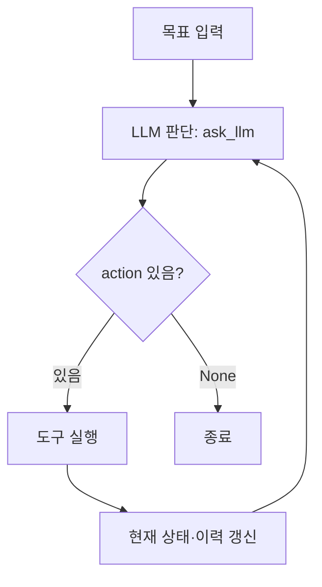

# AI 옆자리과외 #29 — Agent Loop

**제목:** [AI 에이전트 개발] ③ AI 에이전트는 어떻게 스스로 반복 실행할까?

**예상 시간:** 8~10분  
**형식:** 강사·학생 대화형  
**기반 소스:** `agent_core.py`, `agent_runner.py`, `agent_tools.py`, `01_agent_step.ipynb`, `02_agent_run.ipynb`

> 핵심 메시지: LLM은 다음 행동을 판단하고, 하네스는 판단과 실행을 반복해 에이전트가 스스로 작업을 이어가도록 합니다.

## 1. 인트로 — 에이전트가 스스로 일하게 하려면?

*화면: 부산 출장 준비 / KTX 매진 / 버스 검색 성공*

**강사**

지난 시간에 우리는 부산 출장 비서 에이전트를 만들었습니다.

출장 날짜를 확인하고, KTX를 검색했는데 좌석이 모두 매진됐죠.

그런데 에이전트는 여기서 멈추지 않았습니다. 실행 결과를 보고 버스를 검색하는 새로운 판단을 내렸습니다.

**학생**

네. KTX가 매진되니까 다른 교통수단을 선택했죠.

**강사**

맞아요. 그런데 지난 실습에서는 우리가 코드를 한 번씩 실행해야 했습니다.

일정을 확인할 때 한 번, KTX를 검색할 때 한 번, 버스를 검색할 때 또 한 번.

매번 사람이 실행해 줘야 한다면, 이걸 자율적으로 일하는 에이전트라고 할 수 있을까요?

**학생**

그러면 이 과정을 자동으로 반복해야겠네요.

**강사**

바로 그겁니다.

오늘은 에이전트가 스스로 다음 행동을 선택하고 실행하면서, 목표를 달성할 때까지 작업을 이어가는 구조를 만들어 보겠습니다.

이것을 **에이전트 루프, Agent Loop**라고 합니다.

## 2. 지난 시간 복습 — 판단과 실행은 어떻게 연결될까?

*화면: `agent_core.py`와 `agent_runner.py`의 함수 구조*

**강사**

먼저 우리가 만든 소스 구조를 간단히 살펴보겠습니다.

지금 소스는 크게 세 파일로 나누어져 있습니다.

| 파일 | 역할 |
|---|---|
| `agent_core.py` | LLM 판단 요청, 선택한 도구 실행 |
| `agent_tools.py` | 캘린더 확인, 교통편 검색 |
| `agent_runner.py` | 판단과 실행 연결, 상태·이력 관리, 반복 제어 |

**강사**

`agent_core.py`의 `ask_llm()`은 현재 상태와 실행 이력을 보고 다음 행동을 판단합니다.

`execute_action()`은 LLM이 선택한 도구를 실행하고요.

그리고 `agent_runner.py`의 `step()`은 이 두 함수를 연결합니다.

```python
def step(goal, current_state, available_actions, history):
    decision = ask_llm(
        goal=goal,
        current_state=current_state,
        available_actions=available_actions,
        history=history,
    )

    if decision["action"] is None:
        return {"decision": decision, "result": None}

    result = execute_action(decision)
    current_state.update(result)

    history.append({
        "action": decision["action"],
        "arguments": decision["arguments"],
        "reason": decision["reason"],
        "result": result,
    })

    return {"decision": decision, "result": result}
```

**강사**

코드를 보면 `step()`이 하는 일은 명확합니다.

LLM에게 다음 행동을 물어보고, 선택한 도구를 실행합니다. 그리고 실행 결과를 현재 상태와 이력에 기록하죠.

중요한 건, `step()`은 이 과정을 **딱 한 번만 수행한다**는 겁니다.

다음 행동을 판단하려면 다시 호출해야 합니다.

## 3. 첫 번째 실습 — step()을 직접 반복 실행하기

*화면: `01_agent_step.ipynb` 실행*

**강사**

직접 확인해 보겠습니다.

먼저 `01_agent_step.ipynb` 파일을 열겠습니다.

목표는 지난 시간과 같습니다.

“다음 주 부산 출장 준비.”

현재 상태에는 아직 출장 날짜도, 미팅 시간도 없습니다.

```python
goal = "다음 주 부산 출장 준비"

current_state = {
    "trip_date": None,
    "meeting_time": None,
    "transport_type": None,
    "transport_status": None,
    "transport_message": None,
}

available_actions = ["check_calendar", "search_transport"]
history = []
```

**강사**

초기화 셀을 실행하고, `step()`을 호출하겠습니다.

```python
step_result = step(
    goal=goal,
    current_state=current_state,
    available_actions=available_actions,
    history=history,
)
```

### 실행 1 — 출장 일정 확인

**강사**

첫 번째 판단에서 LLM은 `check_calendar`를 선택합니다.

출장 날짜를 모르니까 먼저 캘린더를 확인하는 거죠.

실행 결과로 출장 날짜와 미팅 시간이 저장됩니다.

```text
action: check_calendar
trip_date: 2026-10-08
meeting_time: 14:00
```

**학생**

이제 출장 날짜를 알았으니까 교통편을 검색하겠네요.

**강사**

그렇죠. 그런데 아직 교통편 검색은 실행되지 않았습니다.

`step()`은 한 번의 판단과 실행만 처리하기 때문입니다.

다음으로 넘어가려면 우리가 다시 실행해야 합니다.

### 실행 2 — KTX 검색

**강사**

같은 셀을 다시 실행하겠습니다.

이번에는 출장 일정이 확인되었으니 `search_transport`를 선택하고, `arguments`에 KTX를 지정합니다.

그런데 검색 결과는 매진입니다.

```text
action: search_transport
transport_type: KTX
transport_status: sold_out
KTX 좌석이 매진되었습니다.
```

**강사**

KTX가 매진되었다는 결과도 현재 상태와 실행 이력에 기록됩니다.

이제 다시 실행하면 어떻게 될까요?

### 실행 3 — 버스 검색

**강사**

세 번째로 실행해 보겠습니다.

이번에는 버스를 선택했습니다.

```text
action: search_transport
transport_type: BUS
transport_status: available
버스 좌석이 있습니다.
```

**학생**

이제 이용할 수 있는 교통편을 찾았네요.

**강사**

맞습니다. 그런데 한 번 더 실행해 보겠습니다.

### 실행 4 — 종료 판단

**강사**

이번에는 `action`이 `None`으로 반환됩니다.

이용 가능한 교통편을 찾았으니 더 이상 도구를 실행할 필요가 없다고 판단한 겁니다.

**학생**

그러면 여기서 끝나는 거네요.

**강사**

맞아요.

지금까지 네 번의 판단을 진행했습니다.

그런데 그때마다 우리가 직접 `step()`을 실행했죠.

이제 이 반복을 코드에 맡겨보겠습니다.

## 4. Agent Loop — 반복 실행을 자동화하기

*화면: Agent Loop 동작 구조*

**강사**

우리가 방금 했던 작업을 생각해 보세요.

판단하고, 실행하고, 결과를 저장하고, 다시 판단했습니다.

이 과정을 자동으로 반복하면 됩니다.



**강사**

여기서 중요한 점이 하나 있습니다.

LLM이 직접 반복문을 실행하는 게 아닙니다.

LLM은 매번 다음 행동 하나를 판단합니다.

그리고 **하네스가 LLM의 판단을 받아 도구를 실행하고, 다시 판단하도록 반복을 제어합니다.**

우리가 작성한 `run()`이 바로 그 역할을 합니다.

## 5. 두 번째 실습 — run()으로 자동 실행하기

*화면: `agent_runner.py`의 `run()` 함수*

**강사**

이번에는 `agent_runner.py`의 `run()` 함수를 살펴보겠습니다.

먼저 현재 상태와 실행 이력을 초기화하고, 반복문을 실행합니다.

핵심 부분만 보겠습니다.

```python
for step_number in range(1, max_steps + 1):
    step_result = step(
        goal=goal,
        current_state=current_state,
        available_actions=available_actions,
        history=history,
    )

    decision = step_result["decision"]

    if decision["action"] is None:
        break
```

**강사**

생각보다 간단하죠?

`for` 반복문 안에서 `step()`을 호출합니다.

`step()`은 판단과 실행을 한 번 처리하고 결과를 상태와 이력에 저장합니다.

그러면 반복문이 다시 `step()`을 호출합니다.

이때 LLM은 갱신된 상태와 실행 이력을 보고 다음 행동을 판단합니다.

**학생**

그러면 우리가 직접 여러 번 실행했던 걸 `run()`이 대신하는 거네요.

**강사**

정확합니다.

그리고 `action`이 `None`이면 `break`로 반복을 종료합니다.

여기서 `max_steps`도 중요합니다.

LLM이 계속 행동을 선택하더라도 무한히 반복하지 않도록 최대 판단 횟수를 제한하는 겁니다.

## 6. 실행 결과 — 한 번의 호출로 어디까지 진행할까?

*화면: `02_agent_run.ipynb` 실행*

**강사**

이제 `02_agent_run.ipynb`를 열어보겠습니다.

이번에는 `step()`을 여러 번 호출하지 않습니다.

`run()`을 한 번만 실행하겠습니다.

```python
from agent_runner import run

result = run("다음 주 부산 출장 준비")
```

**강사**

실행 결과를 보겠습니다.

| 판단 | 선택한 행동 | 실행 결과 |
|---|---|---|
| STEP 1 | `check_calendar` | 출장 날짜와 미팅 시간 확인 |
| STEP 2 | `search_transport(KTX)` | KTX 좌석 매진 |
| STEP 3 | `search_transport(BUS)` | 버스 좌석 있음 |
| STEP 4 | `action=None` | 추가 실행 없이 종료 |

최종 상태: **SUCCESS**

**학생**

정말 한 번만 실행했는데 버스까지 찾았네요.

**강사**

그렇죠.

우리가 따로 KTX를 검색하라고 하거나, 버스를 검색하라고 요청하지 않았습니다.

처음에 전달한 목표는 하나였습니다.

“다음 주 부산 출장 준비.”

그런데 에이전트는 실행 결과를 확인하면서 다음 행동을 선택했고, 이용 가능한 교통편을 찾자 스스로 종료했습니다.

이것이 Agent Loop의 핵심입니다.

## 7. 에이전트는 언제 멈출까?

*화면: `agent_runner.py`의 종료 조건과 상태 코드*

**강사**

그런데 여기서 한 가지 더 생각해 보겠습니다.

에이전트가 계속 실행되기만 하면 될까요?

**학생**

아니요. 작업이 끝나면 멈춰야겠죠.

**강사**

맞습니다. 그리고 작업을 완료하지 못했을 때도 무한히 반복해서는 안 됩니다.

우리 코드에는 세 가지 종료 상태가 있습니다.

| 상태 | 의미 |
|---|---|
| `SUCCESS` | 이용 가능한 교통편을 찾고 종료 |
| `INCOMPLETE` | 교통편을 찾지 못하고 종료 |
| `MAX_STEPS` | 최대 판단 횟수에 도달해 종료 |

**강사**

LLM이 `action=None`을 반환하면 `run()`은 현재 상태를 확인합니다.

이용 가능한 교통편을 찾았다면 `SUCCESS`, 그렇지 않다면 `INCOMPLETE`입니다.

반면 LLM이 종료하지 않더라도 정해진 판단 횟수에 도달하면 `MAX_STEPS`로 종료합니다.

이처럼 **언제 반복하고, 언제 멈출지 관리하는 것도 하네스의 중요한 역할**입니다.

참고로 우리 실습에서는 실제 예약이나 결제는 하지 않습니다. `SUCCESS`는 이용 가능한 교통편을 확인했다는 의미입니다.

## 8. 정리 — Agent Loop와 하네스의 역할

*화면: LLM과 Harness 역할 비교*

**강사**

오늘 배운 내용을 정리해 보겠습니다.

지난 시간에는 LLM이 실행 결과를 보고 다음 행동을 선택하는 방법을 배웠습니다.

오늘은 그 판단과 실행을 자동으로 반복하는 Agent Loop를 구현했습니다.

여기서 LLM과 하네스의 역할을 구분해 보겠습니다.

| LLM | Harness |
|---|---|
| 현재 상태와 이력을 보고 다음 행동 판단 | 도구 실행, 상태·이력 관리, 반복과 종료 제어 |
| 다음 `action`과 `arguments` 선택 | 판단을 실제 실행으로 연결 |

**강사**

LLM이 다음 행동을 선택한다고 해서 저절로 에이전트가 완성되는 것은 아닙니다.

그 판단을 실제 행동으로 연결하고, 결과를 다시 판단에 활용할 수 있어야 합니다.

그리고 이 과정을 목표에 도달하거나 종료 조건을 만족할 때까지 반복해야 하죠.

우리는 그 구조를 직접 구현했습니다.

**학생**

그러니까 LLM은 매번 판단하고, 하네스는 그 판단을 실행하면서 전체 과정을 이어가는 거군요.

**강사**

맞습니다.

이제 우리 에이전트는 사람이 매번 실행하지 않아도 스스로 작업을 이어갈 수 있게 됐습니다.

다음 시간에는 에이전트가 목표를 달성하기 위해 여러 작업을 어떻게 계획하는지, **Planner**를 살펴보겠습니다.

그럼 다음 시간에 만나요!

---

## 촬영 전 소스 점검

`agent_runner.py`의 `run()`에 다음 코드가 있습니다.

```python
if decision["action"] is None:
    reson = decision["reason"]

    if current_state["transport_status"] == "available":
        status = "SUCCESS"
    else:
        status = "INCOMPLETE"
    break
```

`reson`은 오타이며 `reason`으로 수정해야 LLM의 종료 이유가 최종 반환값에 반영됩니다.

```python
reason = decision["reason"]
```

현재 코드에서는 `SUCCESS`여도 기본 종료 이유인 “최대 판단 횟수에 도달했습니다.”가 반환될 수 있습니다.

실제 LLM의 `reason` 문장은 실행마다 달라질 수 있으므로, 대본의 실행 결과는 대표적인 예상 흐름입니다.

## 강의 구성 요약

| 구간 | 예상 시간 | 전달할 핵심 |
|---|---:|---|
| 인트로 | 1분 | 왜 반복 자동화가 필요한가 |
| 소스 구조 복습 | 1분 | `step()`의 역할 |
| 첫 번째 실습 | 2분 30초 | 수동으로 4번 판단 |
| Agent Loop 원리 | 1분 | 반복 제어 구조 |
| 두 번째 실습 | 1분 30초 | `run()` 한 번으로 자동 실행 |
| 종료 조건·정리 | 1분 30초 | LLM과 하네스 역할 |

**한 문장 요약:** LLM은 다음 행동을 판단하고, 하네스는 판단과 실행을 반복해 에이전트가 스스로 작업을 이어가도록 합니다.
