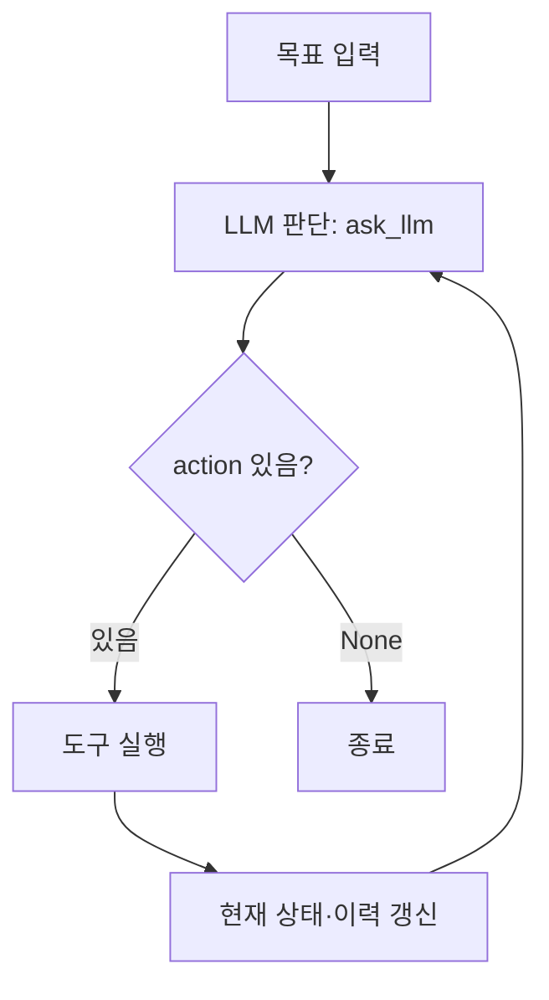

# AI 옆자리과외 #29 — Agent Loop

**버전:** v5.1  
**제목:** [AI 에이전트 개발] ③ AI 에이전트는 어떻게 스스로 반복 실행할까?  
**기반 소스:** `01_agent_step.ipynb`, `02_agent_run.ipynb`, `agent_core.py`, `agent_runner.py`, `agent_tools.py`
Agent Loop 실습
│
├── 01_agent_step.ipynb   # 판단과 실행을 한 번씩 실습
├── 02_agent_run.ipynb    # Agent Loop 자동 실행 실습
│
├── agent_runner.py       # 실행 흐름 제어
│   ├── step()            # 판단 → 실행 → 상태·이력 갱신
│   └── run()             # step() 반복 및 종료 제어
│
├── agent_core.py         # LLM 판단과 도구 실행
│   ├── ask_llm()         # LLM에게 다음 행동 요청
│   ├── execute_action()  # 선택한 도구 실행
│   └── build_decision_schema()
│
└── agent_tools.py        # 실제 도구 구현
    ├── check_calendar()  # 출장 일정 확인
    └── search_transport()# KTX/BUS 좌석 검색

> 핵심: LLM은 현재 상태와 실행 이력을 보고 다음 행동과 실행 인자를 선택하고, Agent Loop는 `step()`을 반복 호출해 작업을 이어갑니다.

## 1. 인트로 — 매번 실행하지 않아도 된다면?

*화면: 지난 편 KTX 매진 → 버스 검색 결과를 빠르게 보여줌*

**강사**

지난 시간에 우리는 부산 출장 비서 에이전트를 만들었습니다.

KTX가 매진되자 버스를 검색하는 것까지 성공했죠.

그런데 매번 우리가 코드를 실행해야 했습니다.

오늘은 이 과정을 자동화해 보겠습니다.

에이전트가 스스로 판단하고 실행하면서, 작업을 끝낼 때까지 반복하도록 만드는 겁니다.

이것을 **Agent Loop**, 에이전트 루프라고 합니다.

바로 실행해 보겠습니다.

## 2. 첫 번째 실습 — step()을 직접 실행하기

*화면: `01_agent_step.ipynb`*

**강사**

먼저 `01_agent_step.ipynb`를 열겠습니다.

`step()`은 LLM의 판단과 도구 실행을 한 번 처리하는 함수입니다.

목표는 부산 출장 준비입니다.

먼저 에이전트가 어떤 목표로 시작할지, 지금까지 확인된 정보는 무엇인지 설정하겠습니다.

*화면: `01_agent_step.ipynb` — 1. 초기화 코드*

```python
from agent_runner import step

goal = "다음 주 부산 출장 준비"

current_state = {
    "trip_date": None,
    "meeting_time": None,
    "transport_type": None,
    "transport_status": None,
    "transport_message": None,
}

available_actions = [
    "check_calendar",
    "search_transport",
]

history = []
```

**강사**

`goal`에는 부산 출장 준비라는 목표를 넣었습니다.

`current_state`에는 아직 확인된 정보가 없으니 모두 `None`으로 시작하고, 사용할 수 있는 도구는 캘린더 확인과 교통편 검색 두 가지입니다.

`history`도 아직 실행한 작업이 없으니 빈 목록으로 두겠습니다.

이 설정을 한 번 실행한 다음, 아래에서 `step()`을 호출해 보겠습니다.

*화면: `01_agent_step.ipynb` — 2. 한 단계 실행 코드*

```python
step_result = step(
  goal=goal,
  current_state=current_state,
  available_actions=available_actions,
  history=history,
)

decision = step_result["decision"]

print("선택한 행동:", decision["action"])
print("실행 인자:", decision["arguments"])
print("선택 이유:", decision["reason"])
print("실행 결과:", step_result["result"])

if decision["action"] is None:
  print("Agent가 종료를 선택했습니다.")
```

### 첫 번째 실행 — 일정 확인

**강사**

먼저 캘린더를 확인했습니다.

출장 날짜와 미팅 시간이 확인됐네요.

그런데 여기서 실행이 끝났습니다.

다음 작업을 하려면 `step()`을 다시 호출해야 합니다.

### 두 번째 실행 — KTX 검색

**강사**

이번에는 KTX를 검색했습니다.

그런데 좌석이 모두 매진됐습니다.

한 번 더 실행해 보겠습니다.

### 세 번째 실행 — 버스 검색

**강사**

이번에는 버스를 검색했고, 이용 가능한 좌석을 찾았습니다.

### 네 번째 실행 — 종료 판단

**강사**

이번에는 `action`이 `None`입니다.

더 이상 실행할 작업이 없다고 판단한 거죠.

**학생**

와, 실행할 때마다 다음 행동을 알아서 선택하네요. 어떻게 스스로 판단하는 거예요?

**강사**

그 부분을 코드에서 확인해 보겠습니다.

*화면: `agent_core.py`의 `ask_llm()` — `client.responses.create()` 부분 확대*

```python
response = client.responses.create(
    model="gpt-5.6",
    input=context_input,
    instructions=DECISION_INSTRUCTIONS,
    text={
        "format": {
            "type": "json_schema",
            "name": "agent_decision",
            "strict": True,
            "schema": decision_schema,
        }
    },
)
```

**강사**

여기서 세 가지만 보겠습니다.

`instructions`에는 **어떤 기준으로 다음 행동을 선택할지** 지침을 넣었습니다. 일정이 없으면 캘린더를 확인하고, KTX가 매진되면 아직 검색하지 않은 버스를 찾도록 한 거죠.

*화면 참고 ①: `agent_core.py`의 `DECISION_INSTRUCTIONS` 중 판단 지침 발췌*

```python
# DECISION_INSTRUCTIONS 안의 실제 지침 일부
# 2. 출장 날짜나 미팅 시간이 없으면
#    check_calendar를 선택하세요.
# 3. 출장 일정이 확인되었고 아직 교통편을 검색하지 않았다면
#    search_transport로 KTX를 검색하세요.
# 4. KTX가 매진되었고 아직 BUS를 검색하지 않았다면
#    search_transport로 BUS를 검색하세요.
# 5. 실행 이력을 확인하고 동일한 조건으로 실패한 검색을 반복하지 마세요.
```

`input`에는 **목표와 현재 상태, 실행 이력, 사용 가능한 도구**를 전달합니다. `step()`이 실행 결과를 상태와 이력에 기록하므로, 다음 호출에서는 달라진 정보를 받게 됩니다.

*화면 참고 ②: `agent_core.py`의 `ask_llm()`에서 실제 입력을 구성하는 코드*

```python
context = {
    "goal": goal,
    "current_state": current_state,
    "available_actions": available_actions,
    "history": history if history is not None else [],
}
context_input = json.dumps(context, ensure_ascii=False)
```

그리고 `text`에는 **응답 형식**을 지정했습니다. LLM이 `action`뿐 아니라 실제 도구 호출에 필요한 `arguments`, 그리고 선택 이유인 `reason`까지 정해진 JSON 구조로 반환하도록 한 겁니다.

*화면 참고 ③: `agent_core.py`의 응답 스키마 연결 부분과 `build_decision_schema()`의 반환 항목 발췌*

```python
decision_schema = build_decision_schema(available_actions)

# client.responses.create()의 text 설정
text={
    "format": {
        "type": "json_schema",
        "name": "agent_decision",
        "strict": True,
        "schema": decision_schema,
    }
}

# build_decision_schema()가 정의하는 최상위 항목
# "required": ["action", "arguments", "reason"]
```

*화면: `action`, `arguments`, `reason` 예시 강조*

```json
{
  "action": "search_transport",
  "arguments": {
    "trip_date": "2026-10-08",
    "meeting_time": "14:00",
    "transport_type": "BUS"
  },
  "reason": "KTX가 매진되어 버스를 검색합니다."
}
```

**강사**

즉, 우리가 다음 행동을 매번 지정하는 게 아닙니다. **LLM이 전달받은 정보와 판단 지침을 바탕으로 실행할 도구와 인자까지 선택**하는 거죠.

**학생**

아, 그래서 KTX가 매진됐다는 결과를 보고 다음에는 버스를 선택할 수 있었군요.

**강사**

맞습니다. 다만 지금은 그 판단을 이어가려고 우리가 `step()`을 네 번 실행했습니다.

이제 그 반복을 자동화해 보겠습니다.

## 3. Agent Loop — 무엇을 반복하는 걸까?

*화면: 아래 흐름도*



**강사**

이 그림은 방금 `step()`을 여러 번 실행했던 흐름입니다.

LLM이 행동을 선택하면 도구를 실행하고, 결과를 상태와 이력에 기록합니다. 그리고 갱신된 정보로 다시 판단하죠.

이 전체 과정을 **`step()` 단위로 반복**하면 됩니다.

**학생**

그런데 KTX도 버스도 `search_transport`를 실행했잖아요. 같은 함수를 다시 실행하는데 어떻게 결과가 달라지는 거죠?

**강사**

좋은 부분을 짚었네요. 함수 이름은 같아도 LLM이 선택한 **실행 인자**가 다릅니다.

KTX를 검색할 때는 `transport_type`이 `KTX`였고, 매진 결과를 확인한 다음에는 `BUS`로 바뀌었습니다.

그래서 같은 도구를 실행해도 **현재 상황과 전달하는 인자에 따라 다른 작업**을 할 수 있습니다.

*화면: `01_agent_step.ipynb`에서 실행한 두 검색의 단계별 기록을 나란히 비교*

| 구분 | STEP 2 — KTX 검색 | STEP 3 — 버스 검색 |
|---|---|---|
| `action` | `search_transport` | `search_transport` |
| `arguments.transport_type` | `KTX` | `BUS` |
| `result.transport_status` | `sold_out` | `available` |
| `result.transport_message` | KTX 좌석이 매진되었습니다. | 버스 좌석이 있습니다. |

```python
# history에서 교통편 검색 두 건만 추려 표시한 예시
[
    {
        "action": "search_transport",
        "arguments": {
            "trip_date": "2026-10-08",
            "meeting_time": "14:00",
            "transport_type": "KTX"
        },
        "result": {
            "transport_type": "KTX",
            "transport_status": "sold_out",
            "transport_message": "KTX 좌석이 매진되었습니다."
        }
    },
    {
        "action": "search_transport",
        "arguments": {
            "trip_date": "2026-10-08",
            "meeting_time": "14:00",
            "transport_type": "BUS"
        },
        "result": {
            "transport_type": "BUS",
            "transport_status": "available",
            "transport_message": "버스 좌석이 있습니다."
        }
    }
]
```

**강사**

기록을 보면 `action`은 똑같이 `search_transport`입니다. 하지만 `arguments`의 교통수단이 KTX에서 BUS로 바뀌었죠. 앞선 검색 결과를 반영해 다음 실행 인자를 다르게 선택한 겁니다.

이제 `step()`을 반복 호출하는 `run()`을 보겠습니다.

## 4. run() 함수 — 반복을 코드에 맡기기

*화면: `agent_runner.py`의 `run()` 핵심 코드*

**강사**

`agent_runner.py`에서 `run()`을 살펴보겠습니다.

핵심은 이 부분입니다.

```python
for step_number in range(1, max_steps + 1):
    step_result = step(
        goal=goal,
        current_state=current_state,
        available_actions=available_actions,
        history=history,
    )

    decision = step_result["decision"]

    if decision["action"] is None:
        break
```

**강사**

`for` 반복문이 `step()`을 계속 호출합니다.

`step()`은 한 번의 판단과 실행을 처리하고, 다음 반복에서는 갱신된 상태와 이력이 다시 전달됩니다.

**학생**

그런데 반복문만 돌리면 KTX가 매진됐는데도 계속 KTX를 검색할 수 있지 않나요?

**강사**

그럴 수 있는지 실제 코드를 따라가 보겠습니다.

*화면: `agent_runner.py`의 `step()` 함수 — 아래 두 줄 강조*

```python
current_state.update(result)

history.append({
    "action": decision["action"],
    "arguments": decision["arguments"],
    "reason": decision["reason"],
    "result": result,
})
```

**강사**

KTX 검색 결과가 `sold_out`이면 `current_state`에 매진 상태가 저장됩니다.

`history`에는 **KTX를 검색했다는 행동과 실행 인자, 매진 결과**가 함께 기록되고요.

다음 `step()`에서 `ask_llm()`은 이 두 정보를 다시 받습니다.

*화면: `agent_core.py`의 `context` 구성과 판단 지침 강조*

```python
context = {
    "goal": goal,
    "current_state": current_state,
    "available_actions": available_actions,
    "history": history if history is not None else [],
}
```

**강사**

그리고 앞에서 본 `instructions`에는 **동일한 조건으로 실패한 검색을 반복하지 말고**, KTX가 매진됐으면 아직 검색하지 않은 버스를 찾도록 지침이 있습니다.

그래서 다음 판단에서는 같은 `search_transport`라도 `transport_type`을 `BUS`로 선택할 수 있는 겁니다.

**학생**

아, 반복문이 버스를 선택하는 건 아니네요. 결과를 기억해서 LLM이 다시 판단할 수 있도록 연결해 주는 거군요.

**강사**

그렇습니다. 반복문은 `step()`을 호출하고, 다음 행동은 LLM이 판단합니다.

여기서 `action`이 `None`이면 `break`로 반복을 끝냅니다.

그리고 `max_steps`는 최대 판단 횟수입니다. 예상하지 못한 상황에서 끝없이 반복하지 않도록 제한하는 거죠.

## 5. 두 번째 실습 — run() 한 번으로 실행하기

*화면: `02_agent_run.ipynb`*

**강사**

이제 `02_agent_run.ipynb`를 열겠습니다.

이번에는 `step()`을 여러 번 실행하지 않고, `run()`을 한 번만 호출해 보겠습니다.

```python
from agent_runner import run

result = run("다음 주 부산 출장 준비")
```

**강사**

실행 결과를 보겠습니다.

| 판단 | 선택한 행동 | 결과 |
|---|---|---|
| STEP 1 | `check_calendar` | 출장 일정 확인 |
| STEP 2 | `search_transport` — KTX | 좌석 매진 |
| STEP 3 | `search_transport` — BUS | 좌석 있음 |
| STEP 4 | `action=None` | 추가 도구 실행 없이 종료 |

**학생**

이번에는 실행 버튼을 한 번만 눌렀는데, 버스 검색까지 다 진행됐네요!

**강사**

그렇죠. `run()`이 `step()`을 반복 호출했고, LLM은 매번 달라진 상태와 이력을 보고 다음 행동을 선택했습니다.

이것이 Agent Loop입니다.

## 6. 언제 반복을 멈출까?

*화면: `agent_runner.py`의 종료 조건*

**학생**

그런데 계속 다음 행동을 선택하면 끝없이 실행될 수도 있겠네요?

**강사**

맞습니다. 그래서 언제 멈출지도 정해야 합니다.

우리 예제에는 세 가지 종료 상태가 있습니다.

| 상태 | 의미 |
|---|---|
| `SUCCESS` | 이용 가능한 교통편을 찾고 종료 |
| `INCOMPLETE` | 이용 가능한 교통편을 찾지 못한 상태로 종료 |
| `MAX_STEPS` | 최대 판단 횟수에 도달해 종료 |

**강사**

LLM이 `action=None`을 선택하면, `run()`은 현재 상태를 확인해 `SUCCESS` 또는 `INCOMPLETE`로 구분합니다.

반복 횟수가 `max_steps`에 도달하면 `MAX_STEPS`로 끝납니다.

여기서 `SUCCESS`는 **교통편을 찾았다는 뜻**이지, 실제 예약이나 결제가 끝났다는 뜻은 아닙니다.

## 7. 정리 — 판단 한 번에서 자동 반복으로

*화면: `step()`과 `run()` 비교*

| `step()` | `run()` |
|---|---|
| 판단과 실행을 한 번 처리 | `step()`을 반복 호출 |
| 실행 결과를 상태·이력에 반영 | 종료 조건과 최대 횟수 관리 |
| 다음 작업에는 다시 호출 필요 | 한 번 호출해 여러 작업 진행 |

**강사**

오늘은 `step()`을 직접 여러 번 실행하던 방식에서, `run()`으로 자동 반복하는 방식으로 바꿨습니다.

LLM은 현재 상태와 실행 이력을 보고 다음 행동과 실행 인자를 선택합니다.

Agent Loop는 그 판단과 실행을 반복하면서 작업을 이어갑니다.

이제 우리 출장 비서 에이전트는 매번 사람이 실행 버튼을 누르지 않아도 스스로 다음 작업을 진행할 수 있게 됐습니다.

**학생**

그럼 다음에는 버스 좌석을 찾자마자 예약까지 해주도록 만들면 되겠네요?

**강사**

그런데 잠깐, 에이전트가 우리가 원하지 않는 시간의 버스를 예약하고 결제까지 해버리면 어떨까요?

**학생**

어, 그건 곤란하죠. 좌석을 찾는 건 알아서 해도, 결제하기 전에는 저한테 물어봐야죠.

**강사**

맞습니다. 지금 예제에는 예약이나 결제 도구가 없어서 그런 일은 일어나지 않습니다.

하지만 나중에 그런 도구를 추가한다면, 자동 실행만으로는 충분하지 않겠죠. 중요한 행동을 하기 전에 사람의 승인을 받는 장치가 필요합니다.

다음 시간에는 **HITL(Human-in-the-Loop)**을 이용해 에이전트가 사람의 확인을 기다렸다가 작업을 이어가도록 만들어 보겠습니다.

**오늘 수업 끝**
